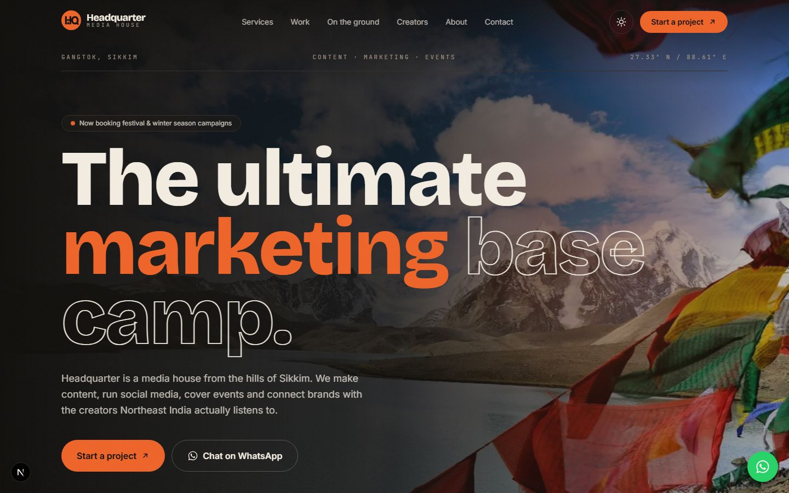
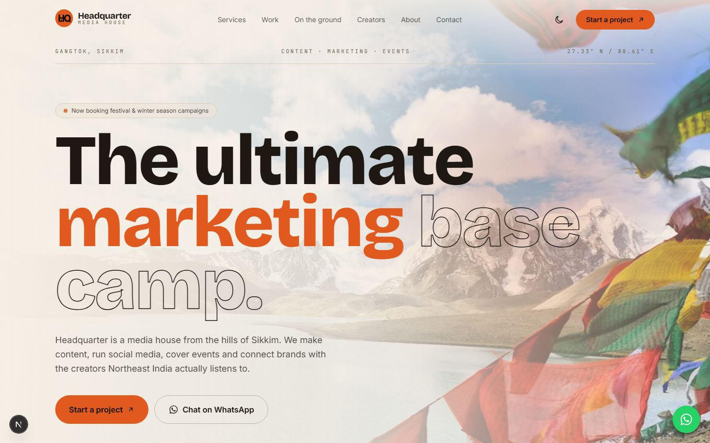
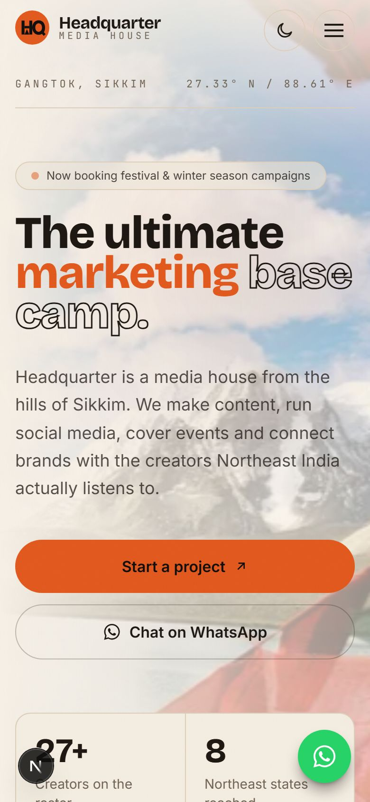

# Headquarter — Website

A website for **Headquarter**, a media house and creative agency from Gangtok, Sikkim:
*"The ultimate marketing base camp. Content. Marketing. Events."*

Built with **Next.js 16**, **React 19** and **Tailwind CSS 4**. One fast, fully static page with light and dark mode, a contact form that never loses a lead, and an identity based on the brand's Instagram: the orange HQ badge and the Himalayas.



| Light mode | Phone |
| --- | --- |
|  |  |

---

## Features

- **Light and dark mode.** A sun/moon toggle in the navbar. It follows the visitor's device setting until they pick a theme, then remembers the choice. The theme is set before the first paint, so the page never flashes the wrong one.
- **A contact form that always delivers.** Briefs open in WhatsApp or the visitor's email app, already written. No server or API key is needed, so the form can't fail silently. There is also a floating WhatsApp button.
- **Built for phones first.** Headlines scale to the screen, the mobile menu is full-screen, and there is no sideways scrolling at 375px.
- **SEO and sharing.** Page metadata, a generated Open Graph share image, `robots.txt`, `sitemap.xml`, JSON-LD business data and an SVG favicon.
- **Accessible.** Labelled form fields with inline errors, keyboard focus states, a skip link, and support for reduced motion.
- **Easy to edit.** All text, services, case studies, Instagram stories and photos are in one file: [`src/lib/site.ts`](src/lib/site.ts).

## Page sections

| # | Section | What it shows |
| --- | --- | --- |
| — | Hero | Tagline, Himalayan photo, calls to action, key numbers |
| 01 | Services | Content, social media, events, campaigns, creators, PR, workshops |
| 02 | Work | Case studies: Chirbirey River Fest, Decathlon, Sikkim Utsav, KFC and more |
| 03 | On the ground | Stories from the Instagram feed |
| 04 | Creators | The 27+ creator roster and a "join the roster" call-out |
| 05 | Process | Seven steps, "from base camp to summit" |
| 06 | About | The team, why HQ, and clients |
| 07 | Contact | WhatsApp, phone, email, Instagram and the project form |

---

## Getting started

Requires **Node.js 20.9 or newer**.

```bash
npm install
```

```bash
npm run dev
```

Then open [http://localhost:3000](http://localhost:3000).

| Command | What it does |
| --- | --- |
| `npm run dev` | Start the development server |
| `npm run build` | Create a production build |
| `npm start` | Serve the production build |
| `npm run lint` | Run ESLint |

## Project structure

```
src/
├── app/
│   ├── layout.tsx            # Fonts, metadata, theme script
│   ├── page.tsx              # Page assembly + JSON-LD
│   ├── globals.css           # Theme tokens (light/dark), animations
│   ├── icon.svg              # Favicon
│   ├── opengraph-image.tsx   # Generated share image
│   ├── robots.ts
│   └── sitemap.ts
├── components/
│   ├── sections/             # Hero, Services, Work, Feed, Creators, Process, About, Contact, Footer
│   ├── ContactForm.tsx       # WhatsApp / email enquiry form
│   ├── Navbar.tsx
│   ├── ThemeToggle.tsx
│   ├── MediaSlot.tsx         # Photo with a branded fallback
│   └── Reveal.tsx            # Scroll-in animation
└── lib/
    ├── site.ts               # ← all editable content
    └── theme.ts
docs/screenshots/             # Images used in this README
```

## Editing content

Everything lives in [`src/lib/site.ts`](src/lib/site.ts):

- `site`: name, email, phone, WhatsApp number, Instagram, domain
- `services`, `work`, `feed`, `process`, `clients`, `reasons`: section content
- `photos`: hero and section background images

### Replacing the placeholder photos

The photos are currently **free placeholders from Unsplash**. Before launch, replace them with Headquarter's own work:

1. Put the images in `public/work/` (case studies) or `public/feed/` (Instagram stories).
2. In `site.ts`, change the entry's `image` to the local path, for example `image: "/work/chirbirey.jpg"`.
3. Point each item in `feed` to its real Instagram reel with `href`.

If an entry has no `image`, it shows a branded mountain graphic instead.

### Colours and themes

The theme tokens are at the top of [`src/app/globals.css`](src/app/globals.css). `ink` is the page background and `cream` is the text; both swap between themes. `night` and `snow` stay fixed, for text on orange or on photos.

---

## Deploying

The site is fully static, so the easiest option is **[Vercel](https://vercel.com/new)**: import the GitHub repo and deploy. No environment variables are needed.

Before going live:

- [ ] Replace the placeholder photos with real ones
- [ ] Set the real domain in `site.url` (`src/lib/site.ts`); it is used for the sitemap, canonical URL and share image
- [ ] Update the Instagram bio link to the new domain
- [ ] Optionally, move to a domain email (for example hello@yourdomain)

---

Made in the Northeast.
